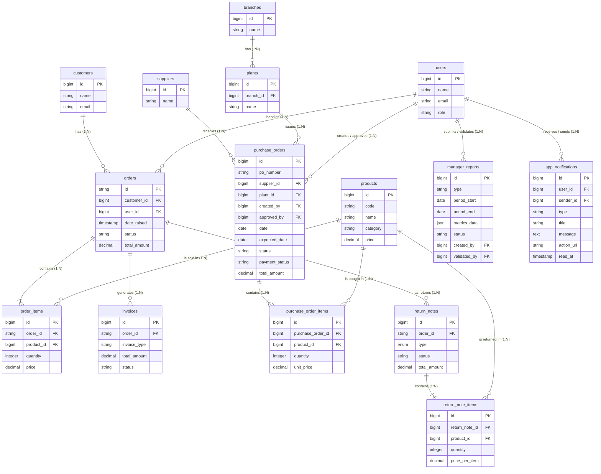

# Entity-Relationship Diagram (ERD) - Finance Metinca

Berikut adalah visualisasi ERD dari database beserta penjelasan lengkap mengenai relasi antar tabel (Many-to-One, One-to-Many, Many-to-Many).

## 1. Visualisasi ERD (Mermaid)

> [!NOTE] 
> Diagram di atas menggunakan sintaks [Mermaid.js](https://mermaid.js.org/) yang didukung oleh GitHub dan sistem Markdown modern. 

---

## 2. Penjelasan Relasi Antar Tabel

Di dalam sistem ini, mayoritas relasi adalah **One-to-Many** (1:N) dan **Many-to-One** (N:1), yang mana jika digabungkan menggunakan tabel perantara (pivot) akan membentuk relasi logis **Many-to-Many** (M:N). 

Berikut adalah detailnya:

### A. Modul Penjualan (Sales)
- **`customers` ke `orders` (One-to-Many)**
  Satu *Customer* bisa memiliki banyak *Order*, tapi satu *Order* hanya milik satu *Customer*.
- **`users` ke `orders` (One-to-Many)**
  Satu *User (Staff/Sales)* bisa menangani banyak *Order*, tapi satu *Order* ditangani oleh satu *User*.
- **`orders` ke `invoices` (One-to-Many)**
  Satu *Order* bisa menghasilkan banyak *Invoice* (misal: *Invoice DP* dan *Invoice Final*), namun satu *Invoice* hanya merujuk ke satu *Order*.
- **`orders` ke `products` (Many-to-Many)**
  Satu *Order* bisa berisi banyak barang (*Products*), dan satu *Product* bisa berada di banyak *Order*. Relasi fisik **Many-to-Many** ini dijembatani oleh tabel perantara/pivot yaitu **`order_items`**.
  - `orders` 1:N `order_items`
  - `products` 1:N `order_items`

### B. Modul Pembelian (Purchasing)
- **`branches` ke `plants` (One-to-Many)**
  Satu *Branch (Cabang)* membawahi banyak *Plant (Pabrik/Unit)*. 
- **`suppliers` ke `purchase_orders` (One-to-Many)**
  Satu *Supplier* bisa menerima banyak *Purchase Order (PO)* dari perusahaan.
- **`plants` ke `purchase_orders` (One-to-Many)**
  Satu *Plant* bisa menerbitkan banyak *Purchase Order (PO)*.
- **`purchase_orders` ke `products` (Many-to-Many)**
  Sama seperti modul *Sales*, *PO* dan produk memiliki relasi logis **Many-to-Many** yang dijembatani oleh tabel pivot **`purchase_order_items`**.
  - `purchase_orders` 1:N `purchase_order_items`
  - `products` 1:N `purchase_order_items`

### C. Modul Retur (Return Notes)
- **`orders` ke `return_notes` (One-to-Many)**
  Satu *Order* bisa mengalami beberapa kali proses retur (pembuatan *Return Note*). 
- **`return_notes` ke `products` (Many-to-Many)**
  Satu dokumen *Return Note* dapat mencakup beberapa *Product* yang diretur, dan satu produk bisa saja diretur di banyak dokumen *Return Note*. Relasi fisik **Many-to-Many** ini dijembatani oleh tabel pivot **`return_note_items`**.
  - `return_notes` 1:N `return_note_items`
  - `products` 1:N `return_note_items`

---
> [!TIP]
> Jika Anda menggunakan ORM (seperti Eloquent di Laravel), tabel-tabel perantara seperti `order_items`, `purchase_order_items`, dan `return_note_items` bisa diimplementasikan menggunakan relasi `belongsToMany` jika tidak membutuhkan model perantara, atau `hasMany` dan `belongsTo` jika Anda membuat Model khusus untuk tabel item tersebut.
