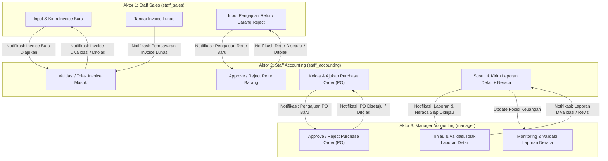

# Rencana Revisi Aplikasi (Issue & Action Plan) — Hasil Seminar CP
**Proyek:** Sistem Informasi Akuntansi & Perekapan Penjualan/Pembelian — **PT. Metinca Prima Industrial Works** (`finance-metinca`)

Dokumen ini berisi perencanaan teknis menyeluruh (*implementation plan*) untuk merevisi aplikasi agar sesuai dengan seluruh poin masukan dan revisi dosen penguji/pembimbing pada Seminar Capstone Project (CP).

---

## Ringkasan Poin Revisi Seminar CP

| Kode | Poin Revisi | Prioritas | Modul / Area Terdampak |
| :--- | :--- | :---: | :--- |
| **ISSUE-01** | Tambah notifikasi untuk setiap kegiatan kirim data antar aktor | Tinggi | Database, Middleware Inertia, Header UI, Seluruh Controller Transaksi |
| **ISSUE-02** | Labeling *"Rekapan penjualan per PT"* diubah menjadi *"Rekapan Penjualan per Customer"* | Tinggi | Sidebar Navigation, Halaman Customer Recap, Halaman Sales Recap |
| **ISSUE-03** | Labeling profile *"Manager User"* diganti dengan yang seharusnya (*"Manager Accounting"*) | Tinggi | `UserSeeder`, Database Users, Komponen `UserInfo`, Header & Dashboard |
| **ISSUE-04** | Laporan pada Manager Accounting dibuat **laporan lebih detail**, bukan hanya *summary* angka | Tinggi | `AccountingController`, `ManagerController`, Halaman `manager/reports.tsx` |
| **ISSUE-05** | Tambah menu **Purchase Order (PO)** sama seperti modul ADI | Tinggi | `PurchaseOrderController`, Routes, Sidebar, Halaman CRUD & Approval PO |
| **ISSUE-06** | Penambahan bagian Manajer terkait **Laporan Neraca (Balance Sheet)** | Tinggi | `ManagerController`, Routes, Sidebar, Halaman `manager/neraca.tsx` |
| **ISSUE-07** | Penyelarasan menyeluruh sesuai revisi dosen hasil Seminar CP (End-to-End Workflow, RBAC, Dokumen & Diagram) | Tinggi | Use Case, ERD, Seeder, Konsistensi Istilah Akuntansi, Feature Tests |

---

## Alur Komunikasi & Pengiriman Data Antar Aktor (Target Revisi)

---

## Detail Perencanaan Teknis per Isu

### ISSUE-01: Tambah Notifikasi untuk Setiap Kegiatan Kirim Data Antar Aktor

#### 1. Analisis Kondisi Saat Ini
* Aplikasi baru memiliki *flash message* sesaat (`session('success')` / `session('error')`) untuk pengguna yang menekan tombol aksi.
* Belum ada tabel penyimpanan notifikasi di database, belum ada lonceng notifikasi (*notification bell*) di *top header* (`resources/js/components/app-sidebar-header.tsx`), dan aktor penerima tidak mendapatkan pemberitahuan saat ada data baru yang dikirim kepadanya.

#### 2. Matriks Pemicu Notifikasi Antar Aktor
Setiap aksi lintas aktor berikut **wajib** menghasilkan *in-app notification* di database:

| No | Kegiatan Kirim Data | Aktor Pengirim | Aktor Penerima | Lokasi Controller | URL Tujuan Klik (`action_url`) |
| :-: | :--- | :--- | :--- | :--- | :--- |
| 1 | Submit Invoice untuk Validasi | `Staff Sales` | Semua `Staff Accounting` | `InvoiceController@submit` | `/accounting/inbox` |
| 2 | Validasi (Setujui) Invoice | `Staff Accounting` | `Staff Sales` (pembuat invoice) | `AccountingController@validateInvoice` | `/sales/invoice-rekap` |
| 3 | Tolak (Revisi) Invoice + Catatan | `Staff Accounting` | `Staff Sales` (pembuat invoice) | `AccountingController@rejectInvoice` | `/sales/invoice-rekap` |
| 4 | Tandai Invoice Lunas | `Staff Sales` | Semua `Staff Accounting` & `Manager Accounting` | `InvoiceController@markAsLunas` | `/accounting/inbox` atau `/manager/sales-recap` |
| 5 | Kirim Pengajuan Retur Barang | `Staff Sales` | Semua `Staff Accounting` | `ReturnController@store` | `/returns` |
| 6 | Setujui / Tolak Retur Barang | `Staff Accounting` | `Staff Sales` (pembuat order) | `ReturnController@approve` & `reject` | `/returns` |
| 7 | Submit Purchase Order (PO) | `Staff Accounting` / `Staff Sales` | `Manager Accounting` | `PurchaseOrderController@submit` | `/purchase-orders` |
| 8 | Approve / Reject Purchase Order (PO) | `Manager Accounting` | Pembuat PO (`Staff Accounting`) | `PurchaseOrderController@approve` & `reject` | `/purchase-orders` |
| 9 | Kirim Laporan Keuangan Detail ke Manager | `Staff Accounting` | Semua `Manager Accounting` | `AccountingController@generateReport` | `/manager/reports` |
| 10 | Validasi / Tolak Laporan oleh Manager | `Manager Accounting` | `Staff Accounting` (`created_by`) | `ManagerController@validateReport` & `rejectReport` | `/accounting/inbox` |

#### 3. Rencana Implementasi
1. **Database & Model:**
   * Buat migrasi `create_app_notifications_table` dengan kolom:
     * `id` (PK), `user_id` (FK ke `users` penerima), `sender_id` (FK nullable ke `users` pengirim), `type` (string: `invoice_submitted`, `invoice_validated`, `invoice_rejected`, `invoice_paid`, `return_submitted`, `return_reviewed`, `po_submitted`, `po_reviewed`, `report_submitted`, `report_reviewed`), `title` (string), `message` (text), `action_url` (string nullable), `is_read` (boolean default `false`), `read_at` (timestamp nullable), `timestamps`.
   * Buat model `App\Models\AppNotification` beserta relasi `notifications()` pada `App\Models\User`.
   * Buat service helper `App\Services\NotificationService` dengan method `notifyUser($userId, ...)` dan `notifyRole($role, ...)` agar mudah dipanggil dari semua controller.
2. **Backend Routes & Shared Props:**
   * Buat `App\Http\Controllers\NotificationController`:
     * `GET /notifications` (daftar semua notifikasi user).
     * `POST /notifications/{id}/read` (tandai satu notifikasi sudah dibaca & redirect ke `action_url`).
     * `POST /notifications/read-all` (tandai semua notifikasi sudah dibaca).
   * Update `App\Http\Middleware\HandleInertiaRequests::share()` untuk membagikan:
     * `notifications.unread_count` (jumlah belum dibaca).
     * `notifications.recent` (10 notifikasi terbaru beserta nama pengirim dan waktu relatif).
     * `sidebar_badges` (jumlah item *pending* di Inbox Validasi Accounting, Inbox Laporan Manager, dan PO Pending).
3. **Frontend UI:**
   * Update `resources/js/components/app-sidebar-header.tsx`: tambahkan komponen **Notification Bell Dropdown** di sebelah kanan header dengan indikator *badge* merah jumlah notifikasi belum dibaca, daftar notifikasi interaktif, tombol *"Tandai Semua Dibaca"*, serta navigasi otomatis saat item notifikasi diklik.
   * Update `resources/js/components/app-sidebar.tsx`: tampilkan angka *badge* dinamis pada menu `Kotak Masuk Validasi`, `Inbox Laporan`, dan `Purchase Order`.

---

### ISSUE-02: Labeling "Rekapan penjualan per PT" Diubah Jadi "Rekapan Penjualan per Customer"

#### 1. Analisis Kondisi Saat Ini
* Di sidebar dan halaman laporan, istilah yang digunakan masih *"Rekapan per PT"*, *"Rekapan per PT (Pelanggan)"*, *"Pilih Pelanggan (PT)"*, dan *"Perusahaan (PT)"*.
* Sesuai revisi dosen, penggunaan kata *"PT"* terlalu sempit karena pelanggan (*customer*) dapat berbentuk CV, badan usaha asing, maupun entitas lainnya, sehingga harus distandarkan menjadi **Customer**.

#### 2. Daftar File yang Akan Diubah
1. **`resources/js/components/app-sidebar.tsx` (Baris 68–74):**
   * Ubah `titleId: 'Rekapan per PT'` $\rightarrow$ `titleId: 'Rekapan Penjualan per Customer'`
   * Ubah `titleEn: 'Customer Statement'` $\rightarrow$ `titleEn: 'Sales Recap per Customer'`
   * Buka akses menu ini untuk `['staff_accounting', 'manager']` agar Manager Accounting juga dapat meninjau rekapan per customer.
2. **`resources/js/pages/portal/reports/customer-recap.tsx`:**
   * Baris 53: `<Head title={t('Rekapan Penjualan per Customer', 'Sales Recap per Customer')} />`
   * Baris 56: `<h1 ...>{t('Rekapan Penjualan per Customer', 'Sales Recap per Customer')}</h1>`
   * Baris 58: Deskripsi disesuaikan menjadi *"Rekapan penjualan dan tagihan per customer beserta perhitungan denda keterlambatan bayar."*
   * Baris 69: `<Label>{t('Pilih Customer', 'Select Customer')}</Label>`
   * Baris 72: Placeholder `--- Pilih Customer ---`
   * Breadcrumbs: `'Rekapan Penjualan per Customer'` / `'Sales Recap per Customer'`.
3. **`resources/js/pages/portal/sales/rekap.tsx` (Baris 47):**
   * Ubah header kolom `<TableHead>{t('Perusahaan (PT)', 'Company (PT)')}</TableHead>` $\rightarrow$ `<TableHead>{t('Nama Customer', 'Customer Name')}</TableHead>`.
4. **`routes/web.php`:**
   * Izinkan `role:staff_accounting,manager` mengakses rute `GET /reports/customer-recap`.

---

### ISSUE-03: Labeling Profile "Manager User" Diganti dengan yang Seharusnya ("Manager Accounting")

#### 1. Analisis Kondisi Saat Ini
* Pada `database/seeders/UserSeeder.php` baris 25, akun untuk role `manager` diberi nama `'Manager User'` (`manager@example.com`), sedangkan dua aktor lainnya sudah sesuai (`'Staff Sales'` dan `'Staff Accounting'`).
* Pada `resources/js/components/user-info.tsx`, profil di pojok kiri bawah sidebar hanya menampilkan `user.name` tanpa keterangan label jabatan (*role*) yang terformat.
* Pada `resources/js/pages/portal/dashboard.tsx` baris 53, judul dasbor hanya tertulis `'Dasbor Manajer'` / `'Manager Dashboard'`.

#### 2. Rencana Implementasi
1. **Seeder & Migrasi Data (`database/seeders/UserSeeder.php` & Migration):**
   * Ubah `['name' => 'Manager User', 'email' => 'manager@example.com', 'role' => UserRole::MANAGER]` menjadi `['name' => 'Manager Accounting', 'email' => 'manager@example.com', 'role' => UserRole::MANAGER]`.
   * Tambahkan `User::where('email', 'manager@example.com')->where('name', 'Manager User')->update(['name' => 'Manager Accounting'])` pada seeder dan migrasi data agar database yang sudah berjalan otomatis ter-update tanpa perlu kehilangan data transaksi.
2. **Komponen Profil User (`resources/js/components/user-info.tsx`):**
   * Tambahkan pemetaan label jabatan resmi berdasarkan `user.role`:
     * `staff_sales` $\rightarrow$ **Staff Sales**
     * `staff_accounting` $\rightarrow$ **Staff Accounting**
     * `manager` $\rightarrow$ **Manager Accounting**
   * Tampilkan *subtitle* / *badge* jabatan di bawah nama pengguna pada sidebar footer (`NavUser`) dan dropdown menu (`UserMenuContent`).
3. **Halaman Dashboard (`resources/js/pages/portal/dashboard.tsx`):**
   * Ubah judul saat `role === 'manager'` menjadi `t('Dasbor Manager Accounting', 'Accounting Manager Dashboard')`.

---

### ISSUE-04: Laporan pada Manager Accounting Dibuat Laporan Lebih Detail (Bukan Sekadar Summary Angka)

#### 1. Analisis Kondisi Saat Ini
* Saat `Staff Accounting` mengirim laporan di `AccountingController@generateReport`, sistem hanya menghitung 6 angka ringkasan (`total_sales`, `total_invoices`, `paid_invoices`, `unpaid_invoices`, `paid_sales`, `unpaid_sales`).
* Di halaman `resources/js/pages/portal/manager/reports.tsx`, `Manager Accounting` hanya melihat 4 kotak angka di panel kanan tanpa tahu daftar invoice mana saja yang masuk dalam laporan tersebut, siapa customernya, produk apa yang terjual, berapa PPN/DP/Retur-nya, maupun opsi untuk mencetak laporan detail.

#### 2. Rencana Implementasi Laporan Detail
1. **Perluasan Data Laporan di Backend (`AccountingController@generateReport` & `ManagerController@inbox`):**
   * Saat laporan digenerate atau dibuka oleh Manager Accounting untuk periode `period_start` s/d `period_end`, sertakan struktur data komprehensif:
     * **A. Ringkasan Keuangan Lengkap (*Financial Summary*):**
       * Penjualan Kotor (*Gross Subtotal*), Total PPN (`tax_amount`), Total Uang Muka (`dp_amount`), Total Retur Disetujui (`approved_returns_amount`), Total Penjualan Bersih (*Net Sales*), Total Kas Masuk / Lunas (`paid_sales`), Total Piutang / Utang Customer (`unpaid_sales`), serta pemisahan nilai penjualan **Domestik** vs **Internasional (Ekspor)**.
     * **B. Tabel Rincian Transaksi Invoice (*Detailed Invoices List*):**
       * Daftar lengkap seluruh invoice tervalidasi pada periode laporan: `invoice_number`, `order_id`, `date_raised`, `validated_at`, `customer_name`, `sales_rep`, `invoice_type` (Domestik/Internasional), `currency`, `exchange_rate`, `subtotal`, `tax_amount`, `dp_amount`, `total_amount`, `status` (`utang`/`lunas`), `due_date`, dan rincian `items` (nama produk, qty, harga satuan, subtotal item).
     * **C. Tabel Breakdown per Customer (*Customer Breakdown*):**
       * Nama Customer, Jumlah Invoice, Total Nilai Pembelian, Total Sudah Dibayar (Lunas), Sisa Piutang (Utang), dan Status Keterlambatan/Denda.
     * **D. Tabel Breakdown Produk Terjual (*Product Sales Breakdown*):**
       * Kode Produk, Nama Produk, Kategori, Total Kuantitas Terjual, Harga Satuan Rata-rata, Total Kontribusi Pendapatan.
     * **E. Tabel Rincian Retur & Pengeluaran PO Periode Terkait:**
       * Daftar `ReturnNote` yang disetujui pada periode tersebut beserta alasan retur dan nilainya, serta ringkasan `PurchaseOrder` pada periode tersebut.
2. **Redesain UI Halaman Laporan Manager (`resources/js/pages/portal/manager/reports.tsx`):**
   * Ubah layout dari panel sempit 1 kolom menjadi **Tampilan Detail Laporan Komprehensif (Multi-Tab / Full Detail View)** ketika sebuah laporan dipilih:
     * **Tab 1: Ringkasan Eksekutif & Keuangan** (KPI lengkap: Gross Sales, PPN, DP, Retur, Net Sales, Piutang vs Lunas, Domestik vs Ekspor).
     * **Tab 2: Rincian Transaksi Invoice & Item** (Tabel seluruh invoice dengan fitur *expand/modal* melihat rincian barang per invoice).
     * **Tab 3: Rekap per Customer & Produk** (Tabel kontribusi per Customer dan per Produk).
     * **Tab 4: Rincian Retur / Potongan Penjualan**.
   * Tambahkan tombol **Cetak Laporan Detail (Print / PDF Resmi ber-Kop PT. Metinca Prima Industrial Works)** dan **Export CSV/Excel** agar Manager Accounting memiliki dokumen fisik/digital yang lengkap saat memvalidasi laporan.

---

### ISSUE-05: Tambah Menu Purchase Order (PO) Sama Seperti ADI

#### 1. Analisis Kondisi Saat Ini
* Di dalam codebase `finance-metinca` sebenarnya **sudah tersedia fondasi database & model** untuk Purchase Order:
  * Model: `App\Models\PurchaseOrder`, `App\Models\PurchaseOrderItem`, `App\Models\Supplier`, `App\Models\Branch`, `App\Models\Plant`.
  * Seeder: `database/seeders/MasterDataSeeder.php` (sudah men-seed data Supplier, Branch, Plant, dan sampel `PurchaseOrder`).
  * Dokumentasi ERD: `erd.md` (Bagian B: Modul Pembelian / Purchasing).
* Namun, **belum ada Controller, Route, Menu di Sidebar, maupun Halaman UI (Frontend)** untuk mengelola Purchase Order, serta belum mengadopsi tampilan & fitur lengkap seperti modul Procurement/PO ADI (KPI Status Cards, Filter Status, Search PO/Supplier, Tabel PO dengan Created By & Approved By, Form Create PO dengan item, aksi Approve/Reject/Receive/Pay, dan Export CSV/Print PO).

#### 2. Rencana Implementasi Modul Purchase Order (PO)
1. **Penyesuaian Schema Database (`purchase_orders`):**
   * Buat migrasi penambahan kolom pada `purchase_orders` agar mendukung fitur lengkap seperti modul PO ADI:
     * `po_number` (string unique, format `PO-2026-001`), `expected_date` / `due_date` (date nullable), `notes` (text nullable), `created_by` (FK nullable ke `users`), `approved_by` (FK nullable ke `users`), `approved_at` (timestamp nullable), `rejection_notes` (text nullable), `payment_status` (`unpaid` / `paid` untuk integrasi ke Neraca).
   * Siklus Status PO: `Draft` $\rightarrow$ `Submitted` (Menunggu Approval Manager) $\rightarrow$ `Approved` (Disetujui Manager / Aktif) $\rightarrow$ `Received` (Barang Diterima / Selesai) atau `Rejected` (Ditolak Manager).
2. **Backend Controller (`App\Http\Controllers\PurchaseOrderController`):**
   * `index()`: Menampilkan daftar PO lengkap dengan relasi `supplier`, `plant.branch`, `items.product`, `creator`, `approver`, serta statistik KPI (`Draft`, `Submitted`, `Approved`, `Received`, `Total Outstanding`, `Paid`).
   * `store()`: Membuat PO baru beserta baris item (`PurchaseOrderItem`), mendukung pemilihan `Supplier` (atau input supplier baru), `Plant/Cabang`, `Expected Date`, dan multi-item `Product` (otomatis menghitung `total_amount`), serta memicu notifikasi ke `Manager Accounting` jika status langsung `Submitted`.
   * `submit($id)`: Mengirim PO berstatus `Draft`/`Rejected` ke `Manager Accounting` (`Submitted`) + kirim notifikasi.
   * `approve($id)` & `reject($id)`: Aksi khusus `Manager Accounting` untuk menyetujui atau menolak PO + kirim notifikasi ke pembuat PO.
   * `markReceived($id)` / `markPaid($id)`: Aksi penyelesaian penerimaan barang (menambah stok produk di gudang) & pelunasan pembayaran PO kepada supplier.
3. **Routing & Sidebar (`routes/web.php` & `resources/js/components/app-sidebar.tsx`):**
   * Tambahkan menu **Purchase Order (PO)** dengan ikon `ShoppingCart` di `app-sidebar.tsx` yang dapat diakses oleh `staff_accounting`, `manager` (serta `staff_sales` untuk melihat referensi PO).
4. **Frontend UI (`resources/js/pages/portal/purchase-orders/index.tsx`):**
   * **4 KPI Summary Cards** (seperti desain ADI): *POs Draft*, *POs Submitted (Menunggu Approval)*, *POs Approved*, *POs Received / Total Nilai PO*.
   * **Filter & Action Bar:** Pencarian nomor PO / nama supplier secara *real-time*, dropdown filter status (`All Status`, `Draft`, `Submitted`, `Approved`, `Received`, `Rejected`), tombol **+ Buat PO Baru (Create PO)**, dan tombol **Export CSV**.
   * **Tabel Data Purchase Order:** Kolom `PO Number`, `Supplier`, `Plant / Cabang`, `Tanggal Buat`, `Target Kirim (Expected)`, `Jumlah Item`, `Total Nilai (Rp)`, `Dibuat Oleh`, `Disetujui Oleh`, `Status Badge`, dan tombol `Aksi` (Lihat Detail / Cetak PO, Submit, Approve/Reject untuk Manager, Tandai Diterima/Lunas).
   * **Modal Create PO & Modal Detail/Print PO:** Form pembuatan PO multi-item produk beserta fitur cetak dokumen resmi Purchase Order ber-kop **PT. Metinca Prima Industrial Works**.

---

### ISSUE-06: Penambahan Bagian Manajer Terkait Neraca (Balance Sheet)

#### 1. Analisis Kondisi Saat Ini
* `Manager Accounting` saat ini hanya memiliki menu `Inbox Laporan` dan `Rekap Penjualan Valid`.
* Belum ada halaman **Laporan Neraca (Balance Sheet)** yang menyajikan posisi keuangan perusahaan (Aktiva/Aset vs Pasiva/Liabilitas & Ekuitas) kepada Manager Accounting.

#### 2. Desain Perhitungan Akuntansi Neraca (Terintegrasi Data Aplikasi)
Dengan adanya modul **Invoice Penjualan**, **Retur Barang**, **Produk/Inventaris**, dan **Purchase Order (PO)**, sistem dapat menyusun **Neraca Keuangan (Balance Sheet)** secara otomatis dan *real-time* berdasarkan periode tanggal (*cut-off*):

| Kelompok Neraca | Akun / Komponen | Sumber Perhitungan Otomatis dari Database |
| :--- | :--- | :--- |
| **AKTIVA (ASET LANCAR)** | **1101 - Kas & Setara Kas** | Saldo Awal Kas + Total Invoice `lunas` + Total `dp_amount` masuk $-$ Total `PurchaseOrder` yang sudah dibayar (`paid`) |
| **AKTIVA (ASET LANCAR)** | **1102 - Piutang Usaha (Accounts Receivable)** | Total nilai `Invoice` tervalidasi berstatus `utang` $-$ `ReturnNote` (`Approved`) |
| **AKTIVA (ASET LANCAR)** | **1103 - Persediaan Barang Dagang (Inventory)** | Akumulasi nilai stok produk di gudang ($\sum \text{products.stock} \times \text{products.price}$) |
| **AKTIVA (ASET TETAP)** | **1201 - Aset Tetap & Inventaris Pabrik (Plant)** | Nilai aset tetap operasional per Plant/Cabang (dikurangi akumulasi penyusutan) |
| **PASIVA (LIABILITAS JANGKA PENDEK)** | **2101 - Utang Usaha / PO Supplier (Accounts Payable)** | Total nilai `PurchaseOrder` berstatus `Approved` / `Received` yang belum dibayar ke Supplier |
| **PASIVA (LIABILITAS JANGKA PENDEK)** | **2102 - Utang Pajak PPN (Tax Payable)** | Akumulasi `tax_amount` (PPN 11%) dari `Invoice` yang telah tervalidasi |
| **PASIVA (LIABILITAS JANGKA PENDEK)** | **2103 - Pendapatan Diterima di Muka (DP)** | Nilai uang muka (`dp_amount`) atas pesanan yang masih berjalan |
| **PASIVA (EKUITAS / MODAL)** | **3101 - Modal Disetor / Ekuitas Awal** | Saldo penyeimbang modal awal operasional perusahaan |
| **PASIVA (EKUITAS / MODAL)** | **3102 - Laba Bersih Periode Berjalan** | Pendapatan Penjualan Bersih $-$ Retur $-$ Beban Pembelian PO / HPP |

$$\text{Total Aktiva (Aset Lancar + Aset Tetap)} = \text{Total Pasiva (Total Liabilitas + Total Ekuitas)}$$

#### 3. Rencana Implementasi
1. **Backend (`ManagerController@neraca` & Route):**
   * Tambahkan route `GET /manager/neraca` (dapat diakses oleh `manager` dan `staff_accounting`).
   * Buat method `neraca(Request $request)` di `ManagerController` dengan filter Periode (`bulan`, `tahun`, atau tanggal *cut-off*) dan Cabang/Plant.
   * Hitung seluruh pos **Aktiva** dan **Pasiva** secara akurat serta sertakan rincian *drill-down* (daftar invoice pembentuk Piutang Usaha, daftar PO pembentuk Utang Usaha, dan daftar produk pembentuk Persediaan).
2. **Menu Sidebar (`resources/js/components/app-sidebar.tsx`):**
   * Tambahkan menu **Laporan Neraca** (`Balance Sheet`) dengan ikon `Scale` / `BarChart3` pada role `manager` (dan `staff_accounting`).
3. **Frontend UI (`resources/js/pages/portal/manager/neraca.tsx`):**
   * **Header & Filter Periode:** Pilihan Bulan/Tahun & tombol **Cetak Neraca (PDF Resmi)** serta **Export Excel/CSV**.
   * **Status Keseimbangan Neraca (*Balance Check Banner*):** Indikator hijau **"NERACA SEIMBANG (BALANCED)"** yang menampilkan `Total Aktiva = Total Pasiva` beserta rasio likuiditas (*Current Ratio*).
   * **Tabel Neraca Dua Sisi (Skontro — Aktiva di Kiri, Pasiva di Kanan):**
     * Menampilkan nomor akun, nama akun, nilai nominal, dan persentase terhadap total aset.
     * Setiap baris akun dapat diklik (*expand/modal drill-down*) oleh Manager Accounting untuk melihat bukti transaksi pembentuk angka tersebut.

---

### ISSUE-07: Penyelarasan Menyeluruh Sesuai Revisi Dosen Hasil Seminar CP

Selain 6 poin spesifik di atas, revisi seminar CP menuntut konsistensi penuh antara dokumentasi perancangan dan aplikasi yang berjalan:

1. **Sinkronisasi Aktor & Hak Akses (RBAC):**
   * Pastikan hanya ada 3 aktor utama yang konsisten di seluruh sistem dan diagram:
     1. **Staff Sales** (`sales@example.com` — role `staff_sales`)
     2. **Staff Accounting** (`accounting@example.com` — role `staff_accounting`)
     3. **Manager Accounting** (`manager@example.com` — role `manager`)
2. **Pembaruan Diagram Use Case & ERD (`generate_uc.cjs`, `generate_uc_2.cjs`, `erd.md`):**
   * Update Use Case Diagram agar mencantumkan *use case* baru: **Mengelola Purchase Order (PO)** dan **Meninjau Laporan Neraca**, serta memperjelas alur notifikasi antar aktor.
   * Update `erd.md` agar menyertakan tabel `app_notifications` dan kolom-kolom baru pada `purchase_orders` serta `manager_reports`.
3. **Kelengkapan Data Seeder (`DatabaseSeeder`, `MasterDataSeeder`, `SalesPortalSeeder`):**
   * Pastikan saat `php artisan migrate:fresh --seed` dijalankan, aplikasi langsung memiliki data demonstrasi yang kaya untuk ujian/sidang:
     * Akun `Manager Accounting` dengan label yang benar.
     * Data Invoice Domestik & Internasional (Draft, Submitted, Utang, Lunas, Rejected).
     * Data Purchase Order (Draft, Submitted, Approved, Received) seperti modul ADI.
     * Data Laporan Detail Manager & Laporan Neraca yang seimbang.
     * Data Notifikasi awal di setiap akun aktor sehingga lonceng notifikasi langsung terlihat berfungsi saat demo.

---

## Urutan Tahapan Eksekusi (Implementation Roadmap)

- [x] **Tahap 1 — Perbaikan Labeling & Profil Aktor (ISSUE-02 & ISSUE-03)**
  - [x] Update `UserSeeder.php` (`Manager User` $\rightarrow$ `Manager Accounting`) dan buat migrasi update user existing.
  - [x] Update `resources/js/components/user-info.tsx` & `dashboard.tsx` untuk menampilkan nama dan badge jabatan `Manager Accounting`, `Staff Accounting`, dan `Staff Sales`.
  - [x] Ubah seluruh label *"Rekapan per PT"* menjadi *"Rekapan Penjualan per Customer"* di `app-sidebar.tsx`, `customer-recap.tsx`, dan `sales/rekap.tsx`.
- [x] **Tahap 2 — Sistem Notifikasi Antar Aktor (ISSUE-01)**
  - [x] Buat migrasi & model `AppNotification` serta `NotificationService`.
  - [x] Buat `NotificationController` dan daftarkan rute `/notifications` di `routes/web.php`.
  - [x] Bagikan data notifikasi & badge counter melalui `HandleInertiaRequests.php`.
  - [x] Pasang pemicu notifikasi di `InvoiceController`, `AccountingController`, `ManagerController`, `ReturnController`, dan `PurchaseOrderController`.
  - [x] Tambahkan komponen Lonceng Notifikasi (*Notification Bell Popover*) di `app-sidebar-header.tsx`.
- [x] **Tahap 3 — Modul Menu Purchase Order / PO (ISSUE-05)**
  - [x] Buat migrasi penyempurnaan tabel `purchase_orders` (`po_number`, `expected_date`, `created_by`, `approved_by`, `notes`, `payment_status`) dan update `MasterDataSeeder.php`.
  - [x] Buat `PurchaseOrderController.php` (index, store, submit, approve, reject, receive/pay) dan rute di `routes/web.php`.
  - [x] Buat halaman `resources/js/pages/portal/purchase-orders/index.tsx` (lengkap dengan KPI Cards, Search, Filter Status, Modal Create PO, Detail/Print PO, Approve/Reject, dan Export CSV) serta tambahkan menunya di `app-sidebar.tsx`.
- [x] **Tahap 4 — Laporan Detail Manager Accounting (ISSUE-04)**
  - [x] Update `AccountingController@generateReport` dan `ManagerController@inbox` untuk menyertakan rincian transaksi invoice, rincian item produk, breakdown per customer, retur, dan ringkasan pajak/DP/piutang.
  - [x] Redesain halaman `resources/js/pages/portal/manager/reports.tsx` menjadi tampilan laporan detail berlapis (Multi-Tab + Tabel Rincian Invoice/Customer/Produk/Retur + Cetak PDF Resmi & Export CSV).
- [x] **Tahap 5 — Bagian Manajer Terkait Laporan Neraca (ISSUE-06)**
  - [x] Buat method `ManagerController@neraca` dan rute `GET /manager/neraca`.
  - [x] Buat halaman `resources/js/pages/portal/manager/neraca.tsx` (Neraca Aktiva vs Pasiva, indikator *Balanced*, drill-down rincian akun, filter periode, dan cetak PDF/Export CSV) serta tambahkan menu **Laporan Neraca** di `app-sidebar.tsx`.
- [x] **Tahap 6 — Verifikasi, Seeder Demo & Pengujian (ISSUE-07)**
  - [x] Update `erd.md` dan skrip diagram use case (`generate_uc.cjs` / `generate_uc_2.cjs`).
  - [x] Jalankan migrasi, seeder, build aset frontend (`npm run build`), dan pengujian fitur (*Pest / PHPUnit tests*).
